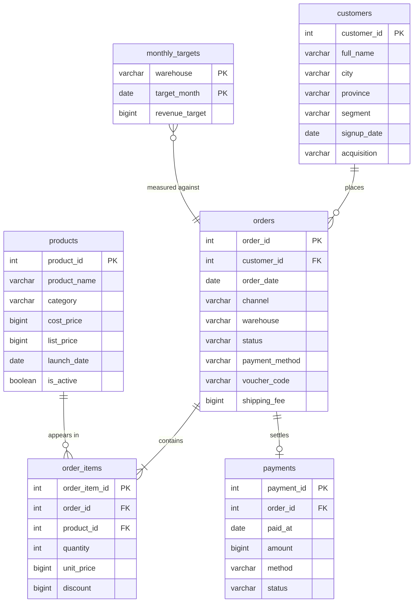

# The case: Nusantara Living

Nusantara Living is an online home and living retailer. It sells furniture, lighting, kitchen,
bedding, decor and storage products across Indonesia, shipping from four warehouses: Jakarta,
Surabaya, Medan and Makassar. Customers buy through three channels: the website, the app, and a
marketplace where the store also lists its catalogue.

The database covers **18 months, January 2025 to June 2026**: 2,405 orders, 5,959 order lines and
Rp 15.8 billion of net revenue from 320 registered customers.

Finance asks the same questions every month:

- How much did we sell, and how fast is that growing?
- What is the gross margin, and which categories carry it?
- Which warehouse is missing its target, and by how much?
- How many orders are cancelled or returned, and where?
- Who are the customers that matter, and when did they last buy?

The 28 tasks in [questions/QUESTIONS.md](questions/QUESTIONS.md) are those questions, split into
steps that build from one table up to a full board report.

## Tables

| Table | Rows | What one row means |
|---|---|---|
| `customers` | 320 | one registered customer, with the city and segment they belong to |
| `products` | 59 | one catalogue product, with its supplier cost and its list price |
| `orders` | 2,405 | one order: date, channel, warehouse, status, payment method, voucher |
| `order_items` | 5,959 | one product line inside an order, with the price actually charged |
| `payments` | 2,405 | the payment attached to an order, settled, failed or refunded |
| `monthly_targets` | 72 | the revenue target of one warehouse for one month |

## Column values you will filter on

| Column | Values |
|---|---|
| `customers.segment` | retail (221), reseller (79), corporate (20) |
| `customers.acquisition` | organic, ads, referral |
| `products.category` | Furniture, Lighting, Kitchen, Bedding, Decor, Storage |
| `orders.channel` | web, app, marketplace |
| `orders.warehouse` | Jakarta, Surabaya, Medan, Makassar |
| `orders.status` | delivered (2,092), cancelled (156), returned (110), shipped (30), paid (17) |
| `orders.payment_method` | va, ewallet, transfer, cod, paylater |
| `orders.voucher_code` | NULL on most orders, otherwise RAMADAN10, AKHIRTAHUN15, NEWUSER, GRATISONGKIR |
| `payments.status` | settled, failed, refunded |

## How the numbers are defined

Money is stored in whole rupiah, so there are no cents anywhere.

| Metric | Formula |
|---|---|
| Net revenue of a line | `quantity * unit_price - discount` |
| Net revenue | the same sum, counting only orders with `status NOT IN ('cancelled', 'returned')` |
| Cost of a line | `quantity * cost_price` from `products` |
| Gross margin | net revenue minus cost |
| Margin percent | `100.0 * gross_margin / revenue` |
| Cancellation rate | cancelled orders divided by all orders of that month or warehouse |
| Achievement | `100.0 * revenue / revenue_target` for that warehouse and month |

`shipping_fee` is charged to the customer but is not part of product revenue, so leave it out
unless a task says otherwise.

## Patterns that are really in the data

Worth knowing, because several tasks ask you to find them:

- Revenue grows month over month, with a spike every March (Ramadan promo) and in December.
- Jakarta is the largest warehouse, Makassar the smallest, and Makassar cancels the most orders.
- Lighting has the best gross margin, Furniture the worst.
- Marketplace orders sell at a small discount, so they carry less margin than web and app orders.
- Decor sales fall through 2026.
- Two products have never been ordered and 24 customers have never placed an order.

## A note on the data

Every row is synthetic, generated by `tools/generate_seed.py` with a fixed seed. Nusantara Living
is not a real company, and no real customer data is used anywhere in this repository.
